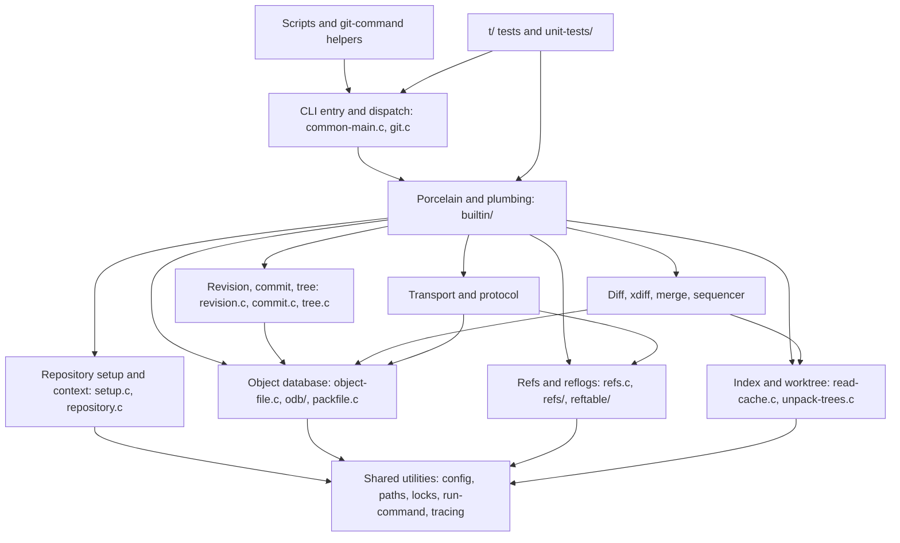
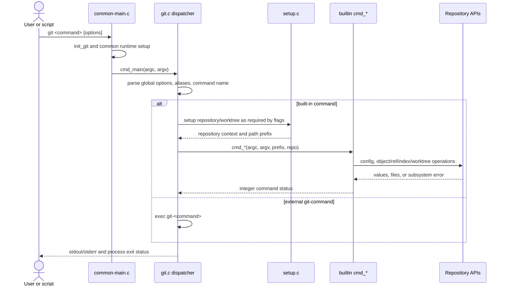
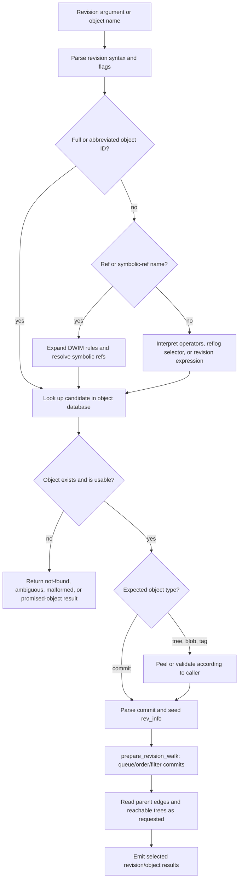
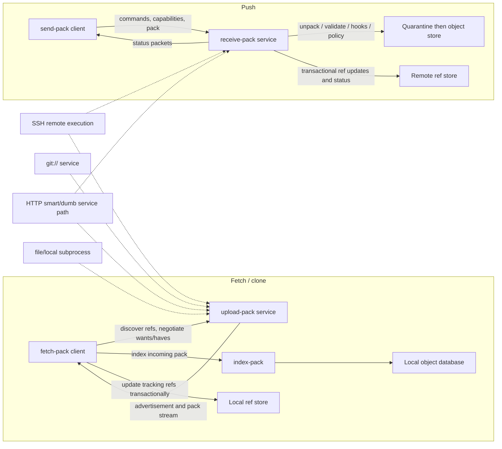
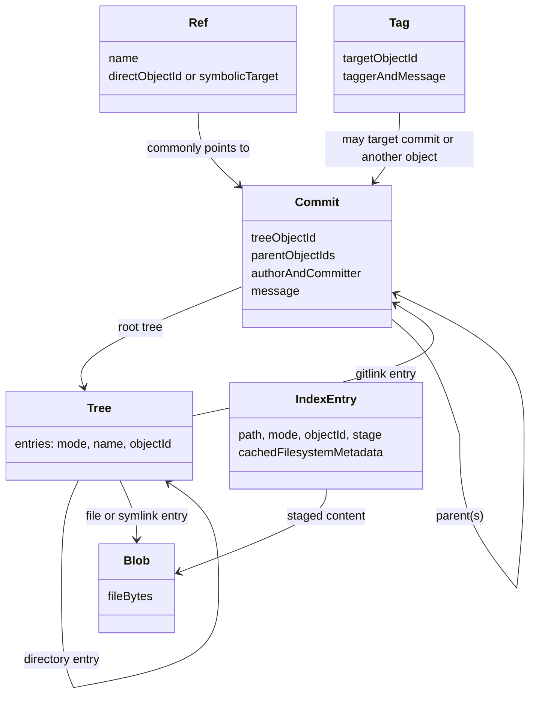
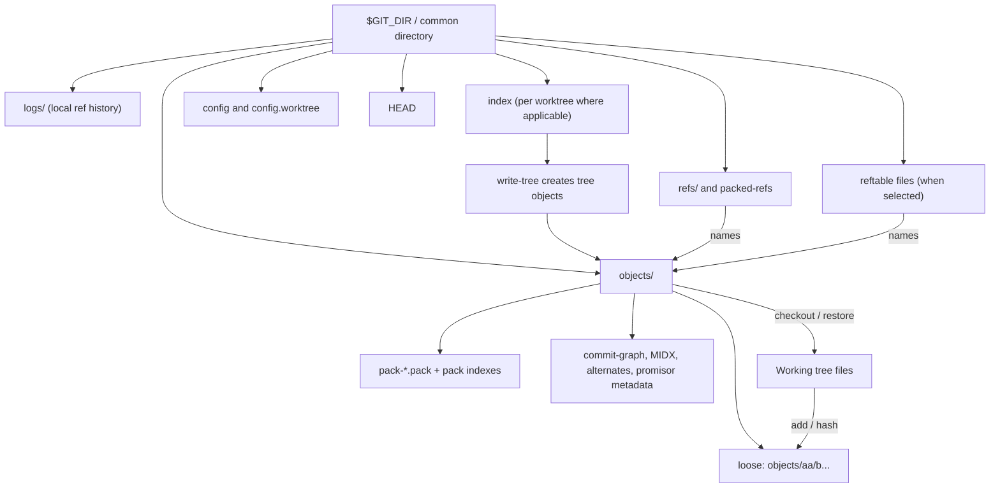
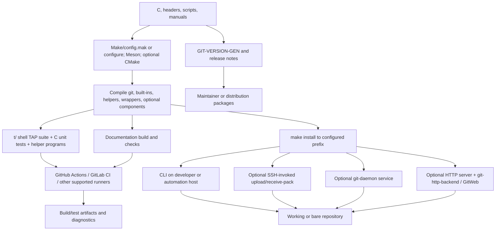

# Architecture Design

Reverse-engineered design notes for the Git source tree in this repository.
This document describes the implementation represented by the checked-out
sources; it is not a promise that every optional feature is built or enabled.

## Contents

- [Scope, audience, and method](#scope-audience-and-method)
- [Overall architecture](#overall-architecture)
- [Modules and subsystem responsibilities](#modules-and-subsystem-responsibilities)
- [Dependencies and entry points](#dependencies-and-entry-points)
- [Command and data flows](#command-and-data-flows)
- [Persistence, object model, and index](#persistence-object-model-and-index)
- [Configuration](#configuration)
- [Authentication, authorization, and trust boundaries](#authentication-authorization-and-trust-boundaries)
- [External integrations](#external-integrations)
- [Business rules and invariants](#business-rules-and-invariants)
- [Errors, patterns, and runtime behavior](#errors-patterns-and-runtime-behavior)
- [Technical debt and risks](#technical-debt-and-risks)
- [Deployment and runtime architecture](#deployment-and-runtime-architecture)
- [From-scratch development procedure](#from-scratch-development-procedure)
- [Implementation-oriented specifications](#implementation-oriented-specifications)
- [Limitations and assumptions](#limitations-and-assumptions)

## Scope, audience, and method

**Scope.** This is an architectural description of the Git implementation in
this source tree, including the core `git` executable, its built-in and
standalone plumbing commands, repository formats, optional clients and
integrations, tests, and build/release machinery. It is not user documentation
for every command.

**Audience.** Git contributors, maintainers, implementers studying Git's
on-disk and wire behavior, and developers planning a compatible implementation.

**Method and evidence labels.**

- **Verified** means the behavior or structure is directly described by a
  source file, build rule, test, or repository specification cited here.
- **Not applicable** means a proposed concept does not describe this project
  (for example, a relational schema or ORM). This does not mean Git has no
  persistent state.
- **Inferred** means a design rationale or consequence deduced from the
  implementation; it is identified as interpretation rather than a documented
  project guarantee.

The primary evidence set was the repository layout, `README.md`, `INSTALL`,
`Makefile`, `configure.ac`, Meson files, CI workflows and scripts, tests under
`t/`, and representative command, repository, object, ref, index, config,
revision, transport, and security code. Existing Git manuals in
`Documentation/` are used as the format and behavior specifications. This is a
source-tree survey, not an exhaustive review of every built-in or every
platform-specific code path.

[Back to top](#architecture-design)

## Overall architecture

Git is a native, primarily C implementation of a distributed version-control
system. Its primary interaction model is a process invoked with a command and
arguments. The core executable initializes shared runtime state, configures the
repository when needed, and dispatches a command to a built-in function or
external `git-<command>` program. Commands combine reusable libraries for
repository setup, object access, refs, index/worktree comparison, revision
walking, diff/merge, and transports.

The repository is a filesystem-backed object/ref/index store, not an
application database. Local commands usually inspect or mutate the selected
repository directly. Network operations use client and service processes that
exchange Git protocol packets and packs. Git also includes distinct optional
interfaces such as GitWeb (CGI), git-gui/gitk (Tcl/Tk), and language-based
extensions; these do not turn the core executable into an HTTP request-handler
application.

### Component and context view

```mermaid
flowchart LR
    User["User or calling program"] -->|argv, stdin, environment| Git["git executable"]
    Git -->|builtin dispatch| Builtins["Porcelain and plumbing built-ins"]
    Git -->|exec git-command| Helpers["External Git helpers and scripts"]
    Builtins --> Core["Repository and algorithm libraries"]
    Helpers --> CoreCLI["Git CLI and plumbing commands"]
    Core --> Repo["Local repository"]
    Repo --> Worktree["Working tree (when present)"]
    Builtins -->|fetch or push| Transport["Transport client"]
    Transport -->|SSH, git, HTTP(S), local process| Service["Remote service process"]
    Service --> RemoteRepo["Remote repository"]
    CGI["Optional GitWeb CGI"] --> Repo
    Desktop["Optional git-gui / gitk"] --> CoreCLI
    Scripts["Hooks, filters, credential helpers"] <--> Builtins
```

The edges to GitWeb and the GUI tools represent separate optional front ends.
GitWeb is a Perl CGI program, and git-gui/gitk are Tcl/Tk applications; neither
is the entry point for normal `git <command>` execution.

[Back to top](#architecture-design)

## Modules and subsystem responsibilities

| Area | Responsibility | Representative implementation |
| --- | --- | --- |
| Process/runtime | Process setup, command parsing and dispatch, child processes, signals, diagnostics, tracing | `common-main.c` (`main`); `common-init.c` (`init_git`); `git.c` (`cmd_main`, `run_argv`, `run_builtin`) |
| Command implementations | Porcelain and plumbing operations; each command owns its option validation and orchestration | `builtin/*.c`; command table in `git.c`; command declarations in `builtin.h` |
| Repository discovery | Find worktree/gitdir, interpret gitfiles/common directories, initialize repository context and path prefix | `setup.c` (`setup_git_directory`, `setup_git_directory_gently`); `repository.c`; `repository.h` |
| Object database | Object IDs, loose-object read/write, pack access, alternate and promisor sources, object parsing | `object-file.c`, `object-name.c`, `odb.c`, `odb/`, `packfile.c`, `commit.c`, `tree.c`, `blob.c`, `tag.c` |
| References | Ref lookup, symbolic-ref resolution, backend selection, ref transactions, reflogs | `refs.c`, `refs/`, `reftable/`, `builtin/update-ref.c` |
| Index and worktree | Read/write the index; stage files; compare trees, index, and filesystem; checkout/unpack | `read-cache.c`, `read-cache.h`, `builtin/add.c`, `unpack-trees.c`, `builtin/checkout.c` |
| Revisions and history | Revision name parsing, commit graph walks, history simplification and ordering | `object-name.c`, `revision.c` (`setup_revisions`, `prepare_revision_walk`), `commit-reach.c` |
| Diff and merge | Change detection, diffcore transformations, xdiff, merge strategies and sequenced operations | `diff.c`, `diffcore-*.c`, `xdiff/`, `merge-ort.c`, `builtin/merge.c`, `sequencer.c` |
| Transport | Remote discovery, protocol selection, fetch/push negotiation, pack transfer, sideband | `transport.c`, `connect.c`, `fetch-pack.c`, `send-pack.c`, `upload-pack.c`, `builtin/receive-pack.c`, `remote-curl.c` |
| Configuration and attributes | Parse layered config, attributes and path conversion behavior | `config.c`, `attr.c`, `convert.c`, `Documentation/config.adoc`, `Documentation/gitattributes.adoc` |
| Optional surfaces | CGI, GUI, language bindings/helpers, completion, credential integrations | `gitweb/`, `git-gui/`, `gitk-git/`, `perl/`, `contrib/`, `contrib/libgit-rs/` |
| Validation and docs | Shell/TAP tests, C helpers and unit tests, format/interop/performance suites, manuals | `t/`, `Documentation/`, `ci/` |

### Layered/module dependency view

The code is not organized as a strict one-way layered application: built-ins
coordinate multiple libraries, and subsystems sometimes call back into shared
services such as configuration, object access, hooks, and process execution.
The following shows the main dependency direction, not every C include or call.



[Back to top](#architecture-design)

## Dependencies and entry points

### Entry points

- `common-main.c:main()` invokes common initialization and then `cmd_main()`.
- `git.c:cmd_main()` handles top-level options and argument normalization;
  `run_argv()` applies aliases and resolves commands.
- `git.c:commands[]` maps built-in names to `cmd_*` function pointers and
  setup flags. `run_builtin()` applies repository/worktree setup and invokes
  the selected function.
- `git.c:execv_dashed_external()` locates an external command as `git-<name>`
  when no built-in handles the command.
- Standalone programs also enter through command-specific mains generated by
  the build (for example, service helpers such as `git-upload-pack`). The
  `builtin/` versions are callable through the main executable and can also
  have dashed wrappers.
- `git daemon`, `git http-backend`, GitWeb CGI, git-gui/gitk, and scripts have
  their own process entry points. They are optional deployment/use modes, not
  universal inbound endpoints.

### Dependencies

The core is C and uses platform/system APIs. `zlib` is a required dependency
for the standard build. Availability and use of libraries and programs such as
libcurl, OpenSSL/crypto providers, gettext, expat, Perl, Tcl/Tk, and SSH are
conditional on build configuration and desired features; `INSTALL`, the
Makefile options, `configure.ac`, and Meson feature options describe these
conditions. The project also contains Rust-facing crates in `contrib/` and a
Cargo build integration; these are not evidence that every Git binary is
implemented in Rust.

The C implementation uses Git's internal utility and subsystem APIs rather
than an application framework, general ORM, or mandatory network server
framework. See `Documentation/technical/build-systems.adoc` for the project
build-system requirements and comparison, and `Documentation/technical/platform-support.adoc`
for platform-support policy.

[Back to top](#architecture-design)

## Command and data flows

Commands accept arguments and often stdin, consult environment/configuration,
operate on repository and/or worktree files, and report results through stdout,
stderr, an exit status, or (for protocol helpers) packet streams. This
command-oriented interface is the normal request/response model; it is not an
HTTP controller pipeline.

### Built-in command execution



### Object-name resolution and revision walking

Name resolution is broader than resolving a branch: accepted names can denote
object IDs, refs, reflog selectors, ancestry operators, or other revision
syntax, depending on the caller and options. `repo_get_oid*()` and related
functions resolve names; `setup_revisions()` parses revision arguments into a
`rev_info`; `prepare_revision_walk()` sets up traversal and callers consume
the results using the revision-walk API.



### Fetch and push protocol flow



Fetching and pushing can run over supported transports, but authentication and
hosting behavior depend on the selected transport/server. Protocol packet and
pack details are specified in `Documentation/gitprotocol-pack.adoc`,
`Documentation/gitprotocol-v2.adoc`, and `Documentation/gitprotocol-http.adoc`.

[Back to top](#architecture-design)

## Persistence, object model, and index

### No relational database or ORM

**Not applicable:** Git's core repository is not backed by a relational
database and has no SQL schema or ORM. Persistent state is stored as object
files, packfiles and indexes, references/reflogs, the index file, configuration
files, and auxiliary metadata under the repository layout. In-memory structs
and caches (for example `struct repository`, `struct object_database`, and
`struct index_state`) are implementation data structures, not ORM entities.

### Object/ref model

Objects are immutable content-addressed values. The canonical logical types
are blob, tree, commit, and annotated tag. Trees name path entries and object
IDs; commits name a root tree and zero or more parent commits; refs name objects
or other refs. The index is a mutable staging snapshot, and the worktree is a
filesystem checkout.



### Physical storage and model boundaries



Loose objects use a `<type> <size>\0` header plus payload, compressed with
zlib; their object ID hashes the uncompressed typed contents. Packs store many
objects compressed, often with delta representation and associated indexes.
Repositories can use SHA-1 or SHA-256 object formats, and may use alternates,
shallow boundaries, or promisor/partial-clone state, so not every local object
store is self-contained. Refs are abstracted behind a storage backend; the
traditional files backend and reftable have different physical layouts.

The index is sorted and includes paths, modes, object IDs, stages, filesystem
stat cache and optional extensions. Stages 1–3 represent unresolved merge
entries; the normal stage is 0. Split and sparse index formats are optional
representations. The index is not a SQL-like normalized file table.

Evidence: `Documentation/gitdatamodel.adoc`,
`Documentation/gitrepository-layout.adoc`, `Documentation/gitformat-loose.adoc`,
`Documentation/gitformat-pack.adoc`, `Documentation/gitformat-index.adoc`,
`Documentation/ref-storage-format.adoc`, `object-file.c`, `odb.c`, `refs.c`,
`refs/files-backend.c`, `reftable/`, and `read-cache.c`.

[Back to top](#architecture-design)

## Configuration

Configuration is key/value text parsed by `config.c`. The standard lookup
sequence includes system, XDG/global, user/global, repository-local,
worktree-specific (when enabled), and command-line parameter scopes. Includes,
environment variables, command-line `-c`, `--config-env`, and per-command
options can affect effective behavior. The exact applicable sources depend on
repository state and the reader's `config_options`.

Configuration is consumed by callbacks and typed accessors rather than by an
application-wide settings object. Attributes (`.gitattributes`) and ignore
rules (`.gitignore`, excludes) are distinct mechanisms with their own readers.
Hooks have a separate executable lookup path, normally `$GIT_DIR/hooks` or
`core.hooksPath`.

Evidence: `config.c` (`config_with_options`, `do_git_config_sequence`,
`git_configset_*`), `Documentation/config.adoc`, `Documentation/git-config.adoc`,
`Documentation/gitattributes.adoc`, `Documentation/gitignore.adoc`,
`Documentation/githooks.adoc`, and `setup.c` (`git_protected_config` callers).

[Back to top](#architecture-design)

## Authentication, authorization, and trust boundaries

Git core does not provide one central user account, login, or repository ACL
system. Trust and access control are distributed across boundaries:

- **Local filesystem boundary:** repository access is subject to the operating
  system's permissions. Repository discovery checks dubious ownership; protected
  config governs `safe.directory` and `safe.bareRepository`.
- **SSH boundary:** remote command execution and identity are supplied by SSH
  and server account/shell policy. Git's service process then receives a
  protocol stream.
- **`git://` boundary:** the protocol is unauthenticated by itself. Network
  exposure and read/write command policy must be handled by the daemon/server
  configuration and deployment environment.
- **HTTP(S) boundary:** HTTP server configuration supplies hosting and any
  authentication/authorization. `git-http-backend` is a CGI-style backend, not
  an independently listening web service.
- **Receive boundary:** `receive-pack` validates proposed updates and applies
  receive configuration, object checks, hooks, and ref-update rules. Hooks are
  executable programs with the server process's privileges; they are a policy
  extension point, not a substitute for a secure server boundary.
- **Untrusted repository/config boundary:** repository data can influence
  parsers, path handling, filters, hooks, and subprocess invocation. Safe
  directory handling, protocol allow-list controls, and validations are
  relevant mitigations; exact behavior is option- and command-specific.

Credential helpers and askpass provide credentials to clients; they do not
authenticate users to Git itself. Signed commits/tags and signed pushes support
verification of identity claims but are separate from transport authorization.

Evidence: `setup.c` (`ensure_valid_ownership`, `safe_directory_cb`),
`Documentation/config/safe.adoc`, `Documentation/gitprotocol-pack.adoc`,
`Documentation/git-http-backend.adoc`, `Documentation/gitcredentials.adoc`,
`builtin/receive-pack.c`, `hook.c`, `Documentation/githooks.adoc`,
`Documentation/config/protocol.adoc`, and `SECURITY.md`.

[Back to top](#architecture-design)

## External integrations

| Integration | How Git uses it | Evidence |
| --- | --- | --- |
| Operating system and filesystem | File I/O, process execution, locks, signals, sockets, path and ownership semantics; compatibility shims handle platform variation | `compat/`, `wrapper.c`, `run-command.c`, `INSTALL`, `Documentation/technical/platform-support.adoc` |
| SSH | Client invokes remote `upload-pack` / `receive-pack`; local executable/configuration supplies authentication | `connect.c`, `transport.c`, `Documentation/gitprotocol-pack.adoc` |
| Git and local transports | `git-daemon` service and local subprocess/direct repository paths | `daemon.c`, `builtin/upload-pack.c`, `connect.c`, `transport.c` |
| HTTP(S) | libcurl-based remote helper/client; server-side CGI backend for smart HTTP; dumb HTTP support also exists | `http.c`, `remote-curl.c`, `http-backend.c`, `Documentation/gitprotocol-http.adoc` |
| Credential systems | Askpass and credential-helper subprocess protocol; optional platform keychain helpers | `credential.c`, `builtin/credential.c`, `contrib/credential/`, `Documentation/gitcredentials.adoc` |
| Filters, hooks, merge/diff tools | Configured subprocesses for content conversion, lifecycle hooks, merge/diff integration | `convert.c`, `hook.c`, `mergetools/`, `Documentation/gitattributes.adoc`, `Documentation/githooks.adoc` |
| Mail and review workflows | `git send-email`, format-patch and related Perl support | `git-send-email.perl`, `perl/Git/`, `Documentation/git-send-email.adoc` |
| Subversion / Perforce | Optional `git svn` Perl and `git p4` Python bridge commands | `git-svn.perl`, `perl/Git/SVN/`, `git-p4.py`, `INSTALL` |
| GUIs and web UI | Optional Tcl/Tk clients and Perl CGI project browser | `git-gui/`, `gitk-git/`, `gitweb/` |
| Build/test providers | Make/autoconf, Meson, optional CMake support, compilers, platform libraries and CI runners | `Makefile`, `configure.ac`, `meson.build`, `contrib/buildsystems/CMakeLists.txt`, `.github/workflows/`, `.gitlab-ci.yml` |

These integrations are conditional. For example, `INSTALL` documents `NO_CURL`,
`NO_PERL`, and `NO_TCLTK`; a binary built without a component does not expose
the associated capability.

[Back to top](#architecture-design)

## Business rules and invariants

The following are core model rules, not a complete enumeration of every
command's policy:

1. Object identity is the selected hash of type, size-delimited contents, and
   payload; object contents are immutable after creation.
2. Trees snapshot directory entries; commits connect snapshots through parent
   links. A commit does not store its parent diff; diff is computed when asked.
3. Refs provide mutable names for objects; symbolic refs resolve through other
   refs. Branch refs conventionally identify commit tips; tags may identify
   other object types.
4. Reachability follows refs/reflogs and object links (tag target, commit
   parents/tree, tree entries). Garbage collection may eventually remove
   unreachable data according to expiration/pruning policy.
5. The index is the commit input snapshot and may temporarily contain multiple
   stages for a conflicted path. `write-tree` requires a tree-compatible index.
6. Ref updates can carry expected old values and are committed through ref
   transactions; update and reflog behavior depend on flags and backend.
7. Worktree/index consistency uses cached filesystem metadata and content checks.
   Filesystem capabilities, timestamp resolution, and conversion attributes
   affect when a cached match is trustworthy.
8. Fetch transfers missing object data and may update selected refs; push
   negotiates proposed ref updates and server-side policy determines acceptance.
9. SHA-1 remains a supported default format, with SHA-256 support and format
   interoperability features; object format is repository metadata, not a
   per-object choice.

Evidence: `Documentation/gitdatamodel.adoc`, format/protocol manuals listed in
the specifications section, `refs.c`, `read-cache.c`, `builtin/receive-pack.c`,
and `Documentation/technical/racy-git.adoc`.

[Back to top](#architecture-design)

## Errors, patterns, and runtime behavior

### Error handling

Errors are generally represented by integer return values and/or shared
diagnostic helpers. `error()` reports a recoverable problem; `warning()` reports
a warning; `die()` terminates on a fatal error; `usage()` terminates for
invalid command syntax. Many command functions return a status that the
dispatcher propagates. Specific exit codes and output are part of each
command's interface, so they must be taken from command manuals and tests, not
assumed uniform. Protocol services also return packet-level error/status
messages. Trace2 and trace facilities expose diagnostic/performance events.

### Design patterns visible in the code

- **Command registry and function-pointer dispatch:** `commands[]` maps names
  to `cmd_*` implementations plus setup flags.
- **Plumbing/porcelain split:** stable user-oriented workflows compose lower
  level commands and common APIs; `Documentation/git(1)` distinguishes command
  categories.
- **Backend and vtable abstraction:** refs and transports select implementations
  behind operation tables; reftable and file refs are alternatives.
- **Transactions and lockfiles:** ref transactions and lockfile/tempfile
  protocols guard updates and publish complete files.
- **Callback and visitor APIs:** config parsing, refs iteration, object
  iteration, and revision traversal separate traversal from client actions.
- **Subprocess adapters:** `run-command.c`, `child_process`, remote helpers,
  hooks, filters, and credential helpers integrate external programs.
- **Lazy setup/caches:** repository contexts, parsed objects, object-name
  lookups and auxiliary graph/index data avoid repeating work.

### Implicit runtime/framework behavior

There is no general application framework. Shared runtime behavior is supplied
by `common-main.c`, `common-init.c`, `git.c`, and low-level utility code:
signal setup, environment handling, repository discovery, path prefixing,
pager selection, alias expansion, locale/gettext, child process handling,
diagnostics, and optional Trace2 instrumentation. Built-in table flags such as
`RUN_SETUP`, `NEED_WORK_TREE`, `USE_PAGER`, and `NO_PARSEOPT` determine setup
and parsing behavior. Commands do not all have identical setup requirements.

Evidence: `usage.c`, `run-command.c`, `trace2/`, `git.c`, `common-init.c`,
`refs.c`, `lockfile.c`, and `Documentation/technical/api-error-handling.adoc`.

[Back to top](#architecture-design)

## Technical debt and risks

These are **observations/inferences**, not claims that maintainers have
classified each item as a defect:

- Git's breadth and long-lived compatibility surface create substantial
  cross-subsystem complexity; command behavior must be preserved across many
  historical formats and options.
- The repository intentionally supports multiple build systems and a wide
  platform set. This expands portability/testing work; `Documentation/technical/build-systems.adoc`
  discusses trade-offs rather than defining a single generator.
- Object formats, ref backends, worktrees, sparse/split indexes, partial clones,
  promisor objects, alternates and compatibility mappings multiply persistence
  cases and validation paths.
- Subprocess-based hooks, filters, helpers, pagers, and external tools inherit
  important security and portability considerations from the environment and
  configured executable paths.
- Filesystem timestamp precision, symlinks, executable bits, case behavior,
  atomic rename guarantees, permissions, and path encodings differ across
  platforms; the code and tests contain compatibility accommodations.
- Not all optional integrations are enabled in every build or CI job; a green
  configuration is not proof that every feature/platform combination was
  exercised.
- Source comments and manuals sometimes describe supported behavior at
  different abstraction levels. In case of conflict, verify current code and
  tests for the specific release/branch being implemented.

**Inferred:** the architecture's compatibility and extension points are
intentional strengths, but also impose a high learning and regression-testing
cost for a from-scratch reimplementation.

[Back to top](#architecture-design)

## Deployment and runtime architecture

Git's ordinary deployment target is a collection of executable programs and
supporting scripts/libraries installed under a configurable prefix. Normal
client operations run as local processes against a working tree or bare
repository. Git can also be used from the build tree through `bin-wrappers/`.
There is no required always-on service, central database, or container
orchestration layer.

Optional server modes are separate processes and hosting integrations:

- SSH hosting invokes `git-upload-pack` and/or `git-receive-pack` over remote
  command execution.
- `git-daemon` serves the Git protocol on a configured listener; the protocol
  itself is not authenticated.
- Smart HTTP hosting uses a web server/CGI integration such as
  `git-http-backend`; HTTP authentication and server lifecycle are external.
- GitWeb is a separate CGI application. Local hooks and configured helpers are
  on-demand child processes.

The repository does not imply any single package format or deployment
environment. `make install`, package maintainers, platform distributions, and
optional web/SSH server administrators control installation and service
configuration.

### Build, test, and release topology



Evidence: `INSTALL`, `Makefile`, `Documentation/Makefile`,
`Documentation/technical/build-systems.adoc`, `t/Makefile`, `t/README`,
`ci/run-build-and-tests.sh`, `ci/test-documentation.sh`, `.github/workflows/`,
`.gitlab-ci.yml`, and `GIT-VERSION-GEN`.

[Back to top](#architecture-design)

## From-scratch development procedure

This is a practical **reconstruction blueprint**, not a statement that Git
currently follows a greenfield sequence. Prefer implementing a coherent,
testable subset at each phase; delaying network features until the local data
model is sound avoids coupling protocol bugs to storage bugs.

### Phase 1 — define compatibility and bootstrap

1. Choose a target language, supported platforms, object hash format(s), and
   initial command set. Define which existing Git formats and protocol versions
   are in scope.
2. Create a portable build with generated feature/configuration settings,
   warnings, dependency detection, installation prefix, and a test target.
   Treat zlib and required system facilities explicitly; make optional
   dependencies disable cleanly.
3. Add common error/status, path, byte-order, hash, filesystem, tempfile/lock,
   environment, subprocess, and tracing APIs before command-specific code.
4. Define process entry and command registry, e.g. `Command { name, run,
   setup_flags }`, with `run(argc, argv, RepositoryContext*) -> ExitStatus`.
5. Milestone: build an executable that reports version/help, dispatches one
   command, emits stable diagnostics, and passes CLI/portability smoke tests.

### Phase 2 — repository and object model

1. Implement repository discovery and initialization: worktree, bare repository,
   `.git` gitfile, common directory, repository format/config, and per-worktree
   paths.
2. Define `ObjectId`, `ObjectType`, `Object { type, bytes }`,
   `RepositoryContext`, and an object database API such as
   `write_object(type, bytes) -> ObjectId`,
   `read_object(oid) -> Object`, and `has_object(oid)`.
3. Implement canonical type/size/payload hashing, compressed loose object
   files, verification, and safe temp-file publication. Begin with immutable
   blobs, then trees, commits, and tags.
4. Add an object parser/serializer with strict bounds checking and tests for
   malformed headers, checksums, missing objects, and both hash-length modes.
5. Milestone: create a repo, hash/write/read objects, verify stable object IDs,
   and inspect them with plumbing commands.

### Phase 3 — references, index, and worktree

1. Implement direct and symbolic refs, `HEAD`, ref-name validation, reflogs,
   iteration, and transactions with expected-old-value checks. Keep the API
   backend-neutral even if the first implementation is loose refs plus
   `packed-refs`; this enables later reftable support.
2. Define `IndexEntry { path, mode, oid, stage, stat_cache }` and a sorted
   `IndexState`. Implement on-disk index parsing/writing with checksums,
   versioned extensions, and lockfile/rename publication.
3. Implement pathspec and ignore/attribute handling; scan the worktree without
   following unsafe paths; compare stat data and content when cache validity is
   uncertain.
4. Add add/update-index, ls-files, read-tree/write-tree, checkout-index and
   status-style operations. Represent merge conflicts with index stages instead
   of inventing persistent conflict tables.
5. Milestone: stage modifications, create a tree from the index, safely
   checkout a tree, and verify index/worktree/HEAD comparisons.

### Phase 4 — revision parsing and history

1. Add full/abbreviated object IDs, ref DWIM resolution, tags, symbolic refs,
   parent/tree peeling, and the syntax required by the selected command subset.
2. Use explicit graph entities and traversal queues. Implement commit parsing,
   reachable walks, date/topological order, boundary and exclusion handling.
3. Add `rev-parse`, `cat-file`, `show-ref`, and `rev-list`-like plumbing before
   porcelain history commands.
4. Add commit-graph, Bloom filters, bitmaps, and other accelerators only after
   correctness is established; each must preserve the same traversal result.
5. Milestone: resolve names unambiguously and produce deterministic history
   output over linear, merge, shallow, and malformed graphs.

### Phase 5 — pack/object access and maintenance

1. Implement pack index lookup, pack parsing, delta resolution, checksum and
   bounds verification, and object iteration. Treat malformed pack input as
   untrusted.
2. Implement pack creation, index-pack, multi-pack lookup, repack, and
   reachability-based maintenance. Keep loose-object support for simple
   development and recovery.
3. Add alternates and partial-clone/promisor semantics only with explicit
   missing-object behavior; never assume a repository is self-contained.
4. Milestone: read and verify external pack fixtures; pack/unpack round trips
   preserve all OIDs and contents.

### Phase 6 — core porcelain, diff, and merge

1. Compose add/commit/branch/tag/status/log/show/reset/restore/checkout around
   the established plumbing APIs. Parse CLI options centrally where possible,
   but preserve command-specific behavior and exit contracts.
2. Implement tree/index/worktree comparisons, diffcore transformations, rename
   detection and a tested line-diff engine. Keep content conversion and
   attributes at well-defined boundaries.
3. Implement three-way merge from merge bases and tree snapshots; model
   conflicts in index stages, support conflict markers and abort/continue state,
   and make multi-step operations recoverable.
4. Milestone: tests cover clean/fast-forward/three-way merges, renames,
   conflicts, executable and symlink modes, path edge cases, and interrupted
   commands.

### Phase 7 — transports and protocol services

1. Implement packet-line framing, flush/delimiter/response-end packets and
   protocol error handling as a reusable layer.
2. Add client transport selection for local/file, SSH and Git protocol, then
   HTTP smart protocol. Model credentials as a client helper interface, not as
   core account authentication.
3. Implement ref advertisement/listing, wants/haves negotiation, pack transfer,
   fetch object installation and ref updates; then push receive validation,
   quarantine, hooks and transactional ref updates.
4. Test protocol version negotiation, shallow and filtered fetches, pack
   corruption, server errors, interruption, and unauthenticated transport
   behavior. Do not expose an unauthenticated write service by default.
5. Milestone: interoperably fetch and push against existing Git in isolated
   test repositories using each claimed protocol.

### Phase 8 — hooks, config, and external helpers

1. Define config parsing, scope precedence, includes, environment overrides,
   protected settings and repository/worktree configuration.
2. Add hooks with explicit working directory, arguments, stdin, environment,
   exit-status behavior and documented bypass policy. Do not execute repository
   configuration or hook paths across a trust boundary without validation.
3. Add credential, filter, editor, pager, merge-tool, and remote-helper
   protocols individually; each helper should have strict input/output and
   subprocess lifetime tests.
4. Milestone: verify config precedence and that hook/helper failures are
   reported without corrupting refs, index, objects, or worktree state.

### Phase 9 — testing, documentation, and hardening

1. Build a unit-test layer for parsers, hashes, serialization, refs, index,
   packet-line and diff primitives; build integration tests around temporary
   repositories with TAP or an equivalent harness.
2. Test black-box CLI output/exit codes, corruption, races, process failures,
   permissions, platform-specific filesystem behavior, and interoperability
   with current Git.
3. Document every on-disk format and protocol before claiming compatibility.
   Keep command manuals, data-model documentation, security guidance and
   implementation notes aligned.
4. Add fuzz targets and static analysis for parsers and object/protocol input;
   apply resource limits and validate all lengths, paths, modes and transitions.
5. Milestone: clean builds, unit and integration suites, format checks,
   sanitizer/static-analysis runs, and interop tests pass on representative
   supported platforms.

### Phase 10 — portability and release engineering

1. Isolate OS-specific filesystem, process, socket, signal and cryptographic
   behavior behind small APIs; maintain capability checks and fallback paths.
2. Validate compiler and dependency combinations in CI, including optional
   features disabled, Windows/macOS/Linux, alternate hash/ref formats and
   sanitizer builds.
3. Provide reproducible version generation, release notes, source archives,
   package/install targets and migration/backward compatibility policy.
4. Milestone: install, upgrade, run tests from the installed prefix, and verify
   source archives and release artifacts on clean environments.

### Suggested core interfaces and sequencing

| API/data structure | Purpose | Needed before |
| --- | --- | --- |
| `ObjectId`, `HashAlgorithm`, `ObjectType` | Strongly typed IDs and typed object hashing | All persistent object features |
| `RepositoryContext` | Worktree, gitdir, common dir, format, object/ref/index providers | Commands and configuration |
| `ObjectDatabase` with `read/write/exists/iterate` | Unified loose/pack/alternate access | Trees, commits, refs validation, transport |
| `RefStore` and `RefTransaction` | Backend-neutral resolution and atomic updates | Branches, commits, fetch/push |
| `IndexState`, `IndexEntry`, stage number | In-memory staging snapshot | Add, status, checkout, commit, merge |
| `RevisionSpec` and `RevisionWalk` | Parse names and traverse parent graphs | Log, merge base, fetch negotiation |
| `LockFile` / `AtomicFile` | Durable publication and cleanup on failure | Index, refs and config writes |
| `PacketReader` / `PacketWriter`, `Transport` | Framed protocol and transport adapter | Fetch/push and service processes |
| `CommandContext` / `ExitStatus` | Consistent CLI and repository setup | All built-ins |

The dependency rationale is: reliable bytes and filesystem operations precede
object serialization; objects precede trees/commits; refs and the index then
make repository state navigable and stageable; history/diff/merge compose those
primitives; pack maintenance enables scale; transport moves verified objects
and refs; hooks/config integrate external policy only after safe process and
trust boundaries exist.

[Back to top](#architecture-design)

## Implementation-oriented specifications

These are concise implementation constraints drawn from the cited repository
manuals, not newly invented formal standards.

| Surface | Implementation-oriented specification | Repository authority |
| --- | --- | --- |
| Object identity and loose storage | Hash the canonical typed object header and payload with the repository hash algorithm. Loose storage contains `<type> <size>\0<payload>`, compressed with zlib and addressed by hash prefix directory plus remaining hex name. Verify size and object ID when reading/writing. | `Documentation/gitformat-loose.adoc`; `Documentation/gitdatamodel.adoc`; `object-file.c` |
| Object graph | Blob holds bytes; tree entries encode mode/name/object ID; commit records tree, zero or more parents, author/committer and message; annotated tag records target/type/tag metadata. Objects are immutable; diffs are derived. | `Documentation/gitdatamodel.adoc`; `Documentation/gitformat-signature.adoc` |
| Packs | Pack readers must validate headers, object boundaries, checksums, indexes and deltas; index files permit object lookup. Do not assume every object has a loose file. | `Documentation/gitformat-pack.adoc`; `Documentation/gitpacking.adoc`; `packfile.c` |
| Repository layout | Support non-bare `.git` directory, bare repository, gitfile, common directory/worktrees, objects, refs, `HEAD`, index, config, logs and optional auxiliary files. Treat alternates and shallow/partial repositories as potentially incomplete. | `Documentation/gitrepository-layout.adoc`; `Documentation/git-worktree.adoc`; `setup.c` |
| Refs | Names are validated; refs may be direct object IDs or symbolic refs. Resolution can follow symrefs; updates support old-value verification and transactions. Branches/tags have conventional namespaces, not distinct SQL entities. | `Documentation/git-refs.adoc`; `Documentation/git-symbolic-ref.adoc`; `Documentation/git-update-ref.adoc`; `refs.c` |
| Ref persistence | Keep storage behind a ref-store API; the files backend and reftable are distinct formats. Ref transaction and reflog guarantees must be tested per backend. | `Documentation/ref-storage-format.adoc`; `Documentation/technical/reftable.adoc`; `refs/refs-internal.h` |
| Index | Read/write the checksummed DIRC index; preserve sorted paths, stages, modes, object IDs, supported versions and extensions. Stage 0 is normal; stages 1–3 represent merge base/side entries. Sparse/split index extensions are optional capabilities. | `Documentation/gitformat-index.adoc`; `Documentation/gitdatamodel.adoc`; `read-cache.c` |
| Configuration | Parse layered system/global/local/worktree/command config; honor includes and per-command typed interpretation. Protected config must remain distinguishable for security-sensitive settings. | `Documentation/config.adoc`; `Documentation/config/safe.adoc`; `config.c` |
| CLI behavior | Parse top-level and command options, stdin/stdout/stderr, environment, repository setup and status per command. Preserve documented usage/error output and exit codes; do not assume one exit convention across unrelated commands. | `Documentation/git.adoc`; `Documentation/gitcli.adoc`; individual `Documentation/git-*.adoc`; `usage.c`; `t/` |
| Transport | Use pkt-line framing and explicitly negotiated capabilities. Fetch uses client `fetch-pack` and service `upload-pack`; push uses `send-pack` and `receive-pack`; pack negotiation transfers required reachable objects and status. SSH, Git, HTTP and local transports differ in framing/hosting/authentication. | `Documentation/gitprotocol-common.adoc`; `Documentation/gitprotocol-pack.adoc`; `Documentation/gitprotocol-v2.adoc`; `Documentation/gitprotocol-http.adoc` |
| Locking and atomicity | For replaceable files, create a lock/temp file, write and validate content, then atomically publish (normally rename); rollback/remove temp files on failure. Ref transactions validate expected prior state; readers should not observe partially written index/ref files. | `lockfile.c`, `lockfile.h`, `read-cache.c`, `refs.c`, `Documentation/technical/api-simple-ipc.adoc` |
| Safety | Validate untrusted serialized inputs and paths; respect filesystem ownership checks and protected config; isolate hook/helper processes and their environment; make server write exposure an explicit deployment decision. | `SECURITY.md`; `setup.c`; `Documentation/config/safe.adoc`; `Documentation/config/protocol.adoc`; `Documentation/githooks.adoc`; `builtin/receive-pack.c` |

[Back to top](#architecture-design)

## Limitations and assumptions

- This document describes one source revision and can become stale as code,
  formats, and supported options change. Verify source and tests before using it
  as an implementation contract.
- Git is primarily compile-time portable native software. `configure.ac`,
  Makefile settings, Meson feature options, `compat/`, and CI adapt to platform
  differences; this is not runtime portability by deploying one universal
  server image.
- Git's core is a CLI/process suite and repository library. Optional services
  (`git-daemon`, `git-http-backend`, `upload-pack`, `receive-pack`) exist, but
  there is no assumption of a permanently running application server or
  application-owned HTTP routing layer.
- Git has no relational database or ORM. “Schema” in this document means the
  documented object, ref, index, config, and auxiliary-file formats.
- Authentication and authorization are transport/server/deployment concerns
  combined with Git's own safety checks, protocol validation, receive policy,
  and hooks. No universal Git account or ACL service is asserted.
- The diagrams are high-level, intentionally omit many commands and optional
  paths, and do not imply that every feature is enabled in every build.
- The from-scratch procedure is an ordered engineering recommendation and
  explicitly inferred sequencing, not a claim about historical Git development.

[Back to top](#architecture-design)
